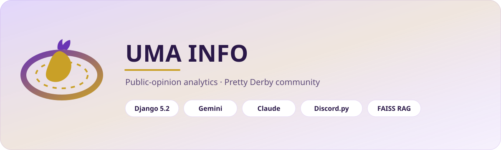
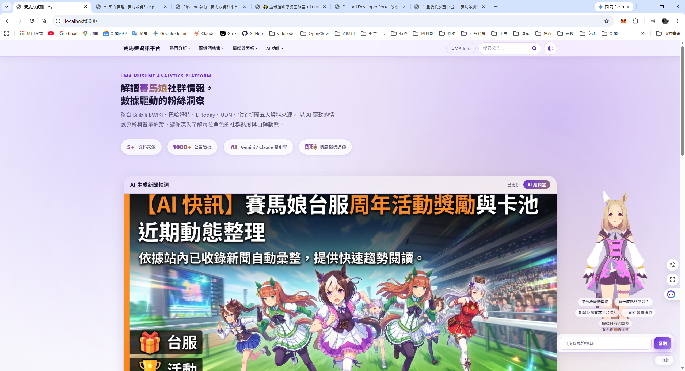
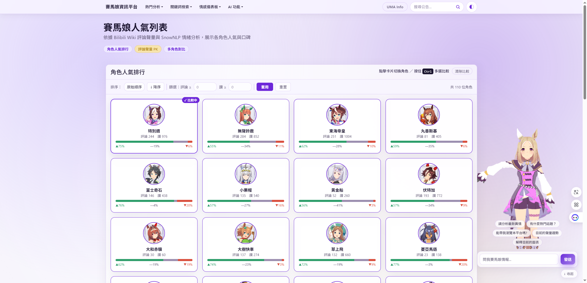
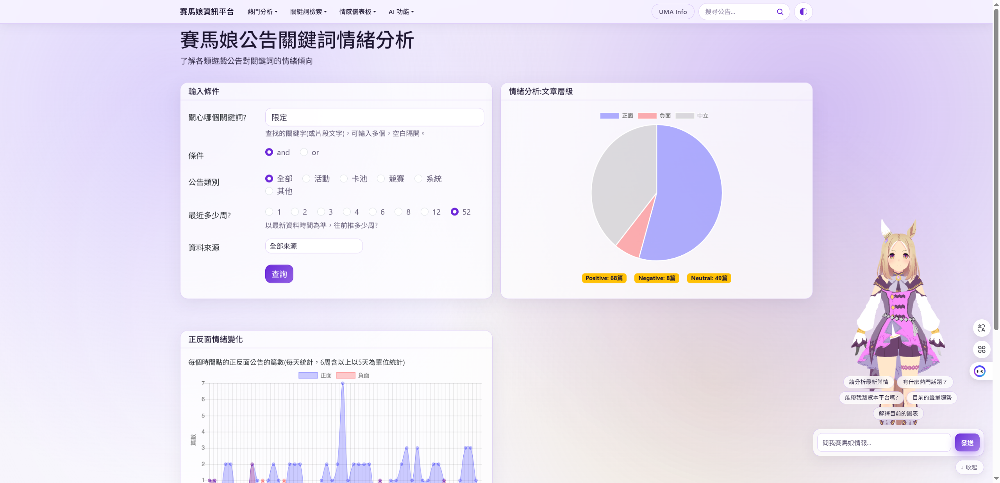
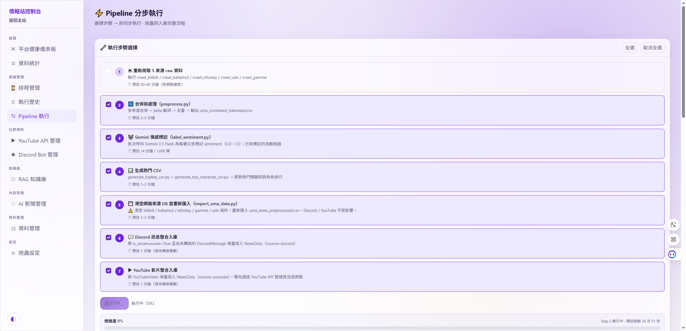
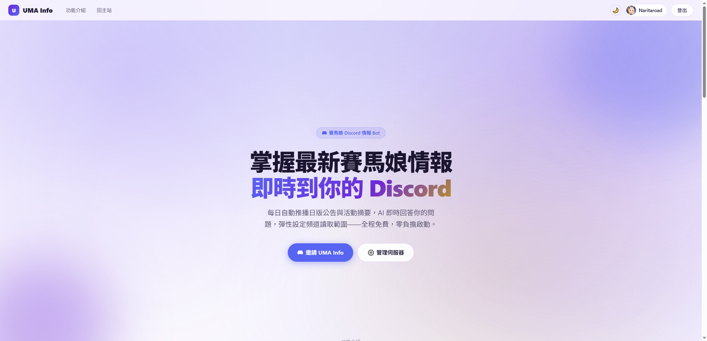
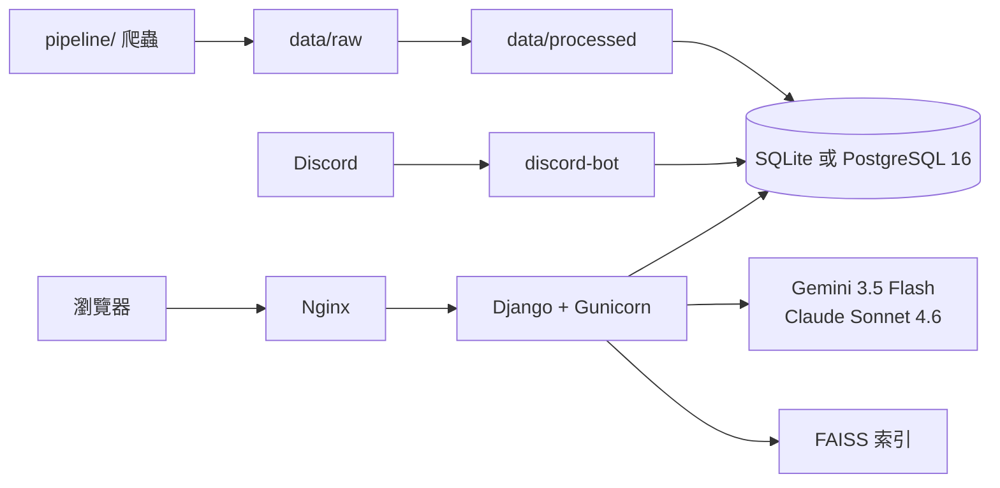

<div align="center">
  <a href="#readme"></a>
  <a href="docs/README.en-GB.md"></a>
</div>

<div align="center">
  
</div>

<h1 align="center">賽馬娘資訊平台</h1>

<div align="center">
  <strong>Uma Musume Information Platform</strong><br>
  把馬娘社群討論收成可查、可畫、可問的輿情系統。<br>
  爬蟲進庫、雙模型寫報告、Agent 回答、Discord 每天推播。
</div>

<div align="center">
  
  
  
  
  
  
  
</div>

<div align="center">
  <a href="#功能">功能</a> ·
  <a href="#示範">示範</a> ·
  <a href="#架構">架構</a> ·
  <a href="#安裝">安裝</a> ·
  <a href="#專案結構">結構</a> ·
  <a href="#貢獻">貢獻</a> ·
  <a href="#授權">授權</a> ·
  <a href="docs/README.md">文件索引</a>
</div>

---

玩家在巴哈、Wiki、新聞與 YouTube 討論卡池與活動，訊息散在六個平台。這個專案把它收進同一套 Django 系統：前台做聲量與情感圖、後台跑 Pipeline、Agent 用站內資料回答、Discord Bot 每天 08:00（台北時間）推播摘要。

> **現況（0.6.61-alpha）**　本機開發用 SQLite；`docker compose` 走 PostgreSQL 16、Nginx、Gunicorn 與 Discord Bot。根目錄 Django apps 已收入 `app/<module>/`，匯入名稱仍是 `app_*`。

本文件是**繁體中文**。英式英文對照：[docs/README.en-GB.md](docs/README.en-GB.md)。

## 功能

<table>
<tr>
<td width="33%" valign="top">

### 輿情圖表

自訂關鍵詞看聲量、共現、正負面折線。熱門詞與角色排行依五類公告（活動／卡池／競賽／系統／其他）出長條圖。首頁有 AI 新聞封面與人氣 PK。

</td>
<td width="33%" valign="top">

### AI 報告與 Agent

Gemini 3.5 Flash 或 Claude Sonnet 4.6 寫 500 字以上繁中報告。另有 Function Calling 助理、FAISS RAG、LangChain / LangGraph 示範頁，以及語意搜尋 + 資料庫雙工具的 Agentic RAG。

</td>
<td width="33%" valign="top">

### 採集與推播

情報站控制台觸發爬蟲、排程、重建 RAG。YouTube Data API v3 看留言情感。Discord 每 30 分鐘增量爬取，雙層篩選後寫入 `NewsData`，並可推到伺服器頻道。

</td>
</tr>
</table>

| 還有這些 | 為什麼這樣做 |
| --- | --- |
| **六個來源、同一契約** | 巴哈、Bilibili BWIKI、ETtoday、UDN、Gamme、YouTube 都進 `data/raw` → `data/processed` → ORM，欄位名稱不亂改。 |
| **雙主題前台** | 深色／亮色、毛玻璃卡片、紫金語意色票；VRM 角色可在側邊問問題。 |
| **本機或 Docker** | 沒設 `DJANGO_DB_ENGINE=postgres` 就用 SQLite；Compose 自動換成 PostgreSQL。 |
| **控制台一次看健康度** | `/crawler-admin/` 顯示筆數、YouTube 配額、Discord 狀態、FAISS 索引是否存在。 |

完整路由與套件版本收在下方〈技術細節〉，規格在 [`SPEC/`](SPEC/INTENT_SPEC.md)。

## 示範

畫面為本機實拍（`http://localhost:8000`）。完整 29 張見 [`docs/screenshots/`](docs/screenshots/)。

<div align="center">
  
</div>
<div align="center"><sub>首頁 AI 新聞精選。右側為成田路 VRM 助理，可直接問站內資料。</sub></div>

<div align="center">
  
</div>
<div align="center"><sub>人氣列表：評論聲量與口碑比例，可多角色 PK。</sub></div>

<div align="center">
  
</div>
<div align="center"><sub>關鍵詞情緒：圓餅分布 + 每日正負面折線，可篩類別與週數。</sub></div>

<div align="center">
  
</div>
<div align="center"><sub>情報站 Pipeline：重爬、前處理、情感標記、匯入 Discord／YouTube，可分步勾選。</sub></div>

<div align="center">
  
</div>
<div align="center"><sub>UMA Info Portal：用 Discord OAuth 管理要推播的伺服器與頻道。</sub></div>

<details>
<summary>更多畫面</summary>

| 檔案 | 畫面 |
| --- | --- |
| [screenshot-08](docs/screenshots/screenshot-08.png) | 各類別熱門關鍵詞長條圖 |
| [screenshot-15](docs/screenshots/screenshot-15.png) | 爬蟲 Cron 排程 |
| [screenshot-18](docs/screenshots/screenshot-18.png) | Discord Bot 管理（訊息量與頻道設定） |

</details>

## 架構



瀏覽器只打 HTTP；Bot 走 Discord Gateway。兩者共用 Django ORM，不另開一條寫入 API。AI 金鑰只從根目錄 `.env` 讀。

模組怎麼分、資料表與 FAISS 路徑見 [docs/ARCHITECTURE.md](docs/ARCHITECTURE.md)。

## 安裝

需要 **Python 3.12+**。完整步驟、環境變數與 Docker 見 [docs/INSTALL.md](docs/INSTALL.md)。

```bash
git clone https://github.com/naritaroad/umamusume-information-platform.git
cd umamusume-information-platform
python -m venv venv
# Windows: venv\Scripts\activate
source venv/bin/activate
pip install -r requirements.txt
cp .env.example .env          # 填入 GEMINI_API_KEY 等
python manage.py migrate
python manage.py runserver
```

開 [http://127.0.0.1:8000](http://127.0.0.1:8000)。

Docker（PostgreSQL + Nginx + Bot）：

```bash
docker compose up -d --build
```

服務會綁在 **http://localhost/**（Nginx :80）。

## 專案結構

```text
umamusume-information-platform/
├── app/                    Django apps（匯入名稱仍為 app_*）
│   ├── analysis/           聲量、情感、人氣、儀表板
│   ├── ingest/             爬蟲控制台、新聞／留言、YouTube
│   ├── agent/              Agent、RAG、LangChain、LangGraph
│   ├── community/          Discord Bot、UMA Info Portal
│   ├── pages/              介紹頁、課程說明
│   └── legacy/             未掛載的課程遺留
├── data/                   raw / processed（契約欄位勿隨意改）
├── knowledge_base/         RAG 文件
├── pipeline/               離線爬蟲與前處理
├── scripts/                匯入與生成工具
├── services/               CSV fallback（過渡期）
├── website_configs/        Django 設定、路由、app_layout.py
├── templates/  static/     全站版型與靜態檔
├── nginx/  docker-files-poa/
├── SPEC/                   意圖／設計／任務規格
└── docs/                   說明、截圖、Hero
```

## 貢獻

請先讀 [`CONTRIBUTING.md`](CONTRIBUTING.md)。摘要：

- 註解用繁體中文；變數 `snake_case`；路由 kebab-case
- 日期 `YYYY-MM-DD`、時間 `HH:MM:SS`，台北時間
- 改 Model 必出 migration；改契約必改爬蟲／SPEC／CHANGELOG
- 不要提交 `.env` 或金鑰

英式英文：[docs/CONTRIBUTING.en-GB.md](docs/CONTRIBUTING.en-GB.md)

## 授權

程式碼以 [MIT](LICENSE) 授權。

**賽馬娘 Pretty Derby** 及相關角色、標誌為 **Cygames, Inc.** 之商標與著作。本專案為課程／粉絲向資訊站，**與官方無關、非商業授權**。截圖中的角色立繪與 VRM 僅供本機展示，請勿再發行遊戲素材。

---

<details>
<summary><strong>技術細節</strong>（套件、路由、環境變數、規格）</summary>

### 技術選型

| 層 | 採用 |
| --- | --- |
| Web | Django 5.2.15 LTS、Gunicorn ≥23、WhiteNoise、Bootstrap 5 |
| 資料庫 | 本機 SQLite；Compose 用 PostgreSQL 16（`psycopg`） |
| AI | `google-genai` 2.9.0（Gemini 3.5 Flash／圖片）、Anthropic 0.111.0（Claude Sonnet 4.6） |
| RAG | faiss-cpu 1.14.2、`gemini-embedding-001` |
| Agent | LangChain ≥1.3、LangGraph ≥0.2 |
| 排程 | APScheduler 3.11.2（4.x 仍為 alpha，不用） |
| Bot | discord.py 2.4.0 |
| 爬蟲 | requests、Beautiful Soup、jieba、OpenCC |

版本查證基準：2026-06-22（見 `SPEC/DESIGN_SPEC.md` §0）。`gemini-2.0-flash` 已停服；不要用已棄用的 `google-generativeai`。

### 路由總表

```text
/                          首頁 AI 新聞
/popularity-list/          人氣列表
/introduction/             平台介紹
/course/                   課程技術說明
/userkeyword/              關鍵字聲量
/userkeyword_assoc/        全文關聯
/userkeyword_senti/        關鍵詞情感
/userkeyword_db/           ORM 全文搜尋
/userkeyword_report/       雙模型 AI 報告
/uma_top_keyword/          熱門關鍵詞
/uma_top_character/        熱門角色
/correlation/              相關性熱力圖
/dashboard/                公告儀表板
/comment_sentiment/        留言情感排程
/agent/                    Function Calling 助理
/rag/                      RAG 問答
/rag-agent/                Agentic RAG
/langchain-agent/          LangChain Agent
/langgraph-agent/          LangGraph Agent
/youtube/                  YouTube 情感
/discord/                  Discord 儀表板
/uma-info/                 UMA Info Portal
/crawler-admin/            情報站控制台
/admin/                    Django Admin
```

### 環境變數（節錄）

複製 [`.env.example`](.env.example) 為 `.env`。至少需要：

| 變數 | 用途 |
| --- | --- |
| `DJANGO_SECRET_KEY` | Django 密鑰 |
| `GEMINI_API_KEY` | 報告、Agent、情感標記、RAG |
| `ANTHROPIC_API_KEY` | Claude 報告（可選） |
| `YOUTUBE_API_KEY` | YouTube 儀表板（可選） |
| `DISCORD_BOT_TOKEN` | Bot（可選） |

完整清單與 Docker 資料庫變數見 [docs/INSTALL.md](docs/INSTALL.md)。

### 規格與紀錄

| 文件 | 說明 |
| --- | --- |
| [SPEC/INTENT_SPEC.md](SPEC/INTENT_SPEC.md) | 為什麼做、使用者場景 |
| [SPEC/DESIGN_SPEC.md](SPEC/DESIGN_SPEC.md) | 架構、資料契約、畫面 |
| [SPEC/TASK_SPEC.md](SPEC/TASK_SPEC.md) | 任務與驗收 |
| [CHANGELOG.md](CHANGELOG.md) | 版本紀錄（Keep a Changelog） |

</details>

<div align="center">
  <sub>以 AI 追蹤馬娘社群脈動 · Django · Gemini · Claude · LangChain · Discord.py</sub>
</div>
