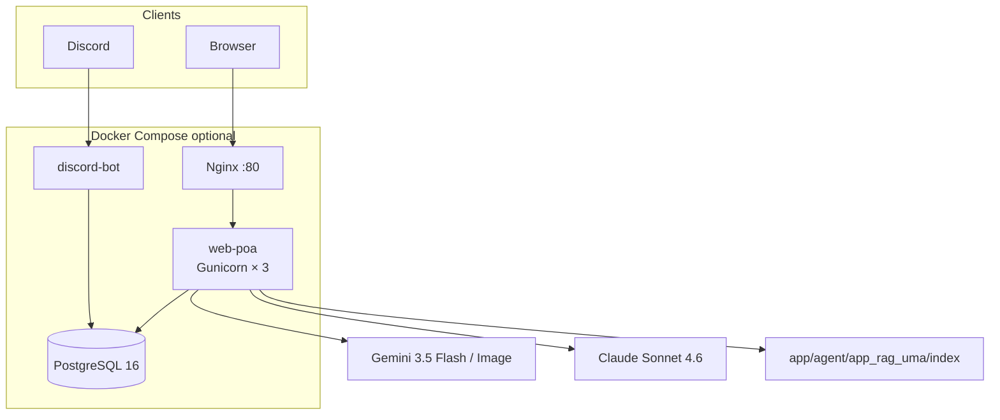
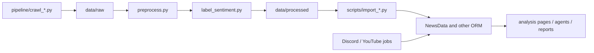

# Architecture

Languages: [繁體中文](ARCHITECTURE.md) · [English (UK)](ARCHITECTURE.en-GB.md)

Back to: [README (zh)](../README.md) · [README (en-GB)](README.en-GB.md) · [docs index](README.md)

Where this disagrees with running code, **the code wins** — then update [`SPEC/DESIGN_SPEC.md`](../SPEC/DESIGN_SPEC.md).

## Runtime topology

`runserver` on a laptop skips Nginx and Postgres and uses the Django development server plus SQLite (`BASE_DIR / db.sqlite3`).

## Data flow

Core column names and order in `data/raw` and `data/processed` **must not be changed casually**. A contract change needs the crawler, preprocess, import scripts, SPEC, and CHANGELOG updated together.

## Where Django apps live

Python still does `import app_character_pk`. Physical folders are mapped in [`website_configs/app_layout.py`](../website_configs/app_layout.py); start-up puts `app/<module>/` on `sys.path`.

| Directory | Apps |
| --- | --- |
| `app/analysis/` | popularity PK, keyword suite, top terms / characters, correlation, dashboard |
| `app/ingest/` | intelligence console, announcements, comments, sentiment jobs, YouTube |
| `app/agent/` | `app_agent_uma`, RAG, RAG agent, LangChain, LangGraph |
| `app/community/` | Discord bot, UMA Info Portal |
| `app/pages/` | introduction and course pages |
| `app/legacy/` | course leftovers not in `INSTALLED_APPS` |

FAISS index: `app/agent/app_rag_uma/index/uma_knowledge.faiss`. Use `rag_index_file()`; do not hard-code a root-level path.

## Requests and safety

- Writes (POST / PUT / PATCH / DELETE) must send `X-CSRFToken`
- In-site URLs: `` in templates, `reverse()` in Python
- Route slugs are kebab-case (for example `/crawler-admin/`)
- Secrets come only from `.env`; missing values should raise a readable error, not fail silently

## Time zone

Dates are `YYYY-MM-DD`, times `HH:MM:SS`, `TIME_ZONE = Asia/Taipei`.
