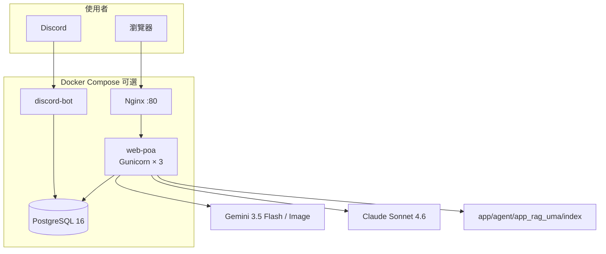
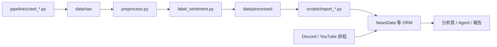

# 架構

語言：[繁體中文](ARCHITECTURE.md) · [English (UK)](ARCHITECTURE.en-GB.md)

回到：[README](../README.md) · [文件索引](README.md)

契約細節以程式碼為準，衝突時改 [`SPEC/DESIGN_SPEC.md`](../SPEC/DESIGN_SPEC.md)。

## 執行時拓樸

本機 `runserver` 略過 Nginx 與 Postgres，改打 Django 開發伺服器 + SQLite（`BASE_DIR / db.sqlite3`）。

## 資料流

`data/raw` 與 `data/processed` 的**核心欄位名稱與順序不得任意變更**。要改契約就同步爬蟲、前處理、匯入腳本、SPEC 與 CHANGELOG。

## Django apps 放哪

Python 仍 `import app_character_pk`。實體目錄由 [`website_configs/app_layout.py`](../website_configs/app_layout.py) 對照，啟動時把 `app/<module>/` 加進 `sys.path`。

| 目錄 | 掛載的 apps |
| --- | --- |
| `app/analysis/` | 人氣 PK、關鍵字系列、熱門詞／角色、相關性、儀表板 |
| `app/ingest/` | 情報站控制台、公告、留言、情感排程、YouTube |
| `app/agent/` | `app_agent_uma`、RAG、RAG Agent、LangChain、LangGraph |
| `app/community/` | Discord Bot、UMA Info Portal |
| `app/pages/` | 平台介紹、課程頁 |
| `app/legacy/` | 未列入 `INSTALLED_APPS` 的課程作業 |

FAISS 索引：`app/agent/app_rag_uma/index/uma_knowledge.faiss`。請用 `rag_index_file()`，不要寫死根目錄路徑。

## 請求與安全

- 寫入（POST／PUT／PATCH／DELETE）必須帶 `X-CSRFToken`
- 站內 URL：Template 用 ``，Python 用 `reverse()`
- 路由 slug 用 kebab-case（例如 `/crawler-admin/`）
- 金鑰只從 `.env` 來；缺少時回傳可判讀的錯誤，不要靜默失敗

## 時區

全部日期 `YYYY-MM-DD`、時間 `HH:MM:SS`，`TIME_ZONE = Asia/Taipei`。
