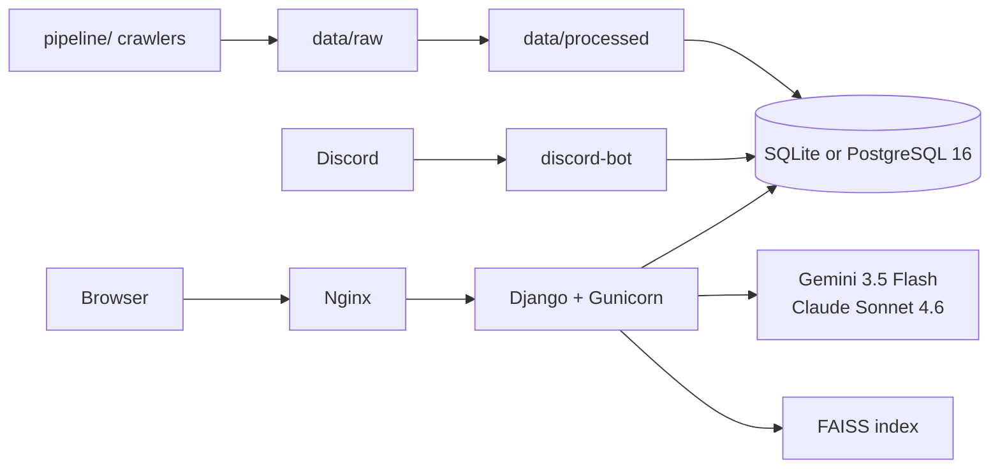

<div align="center">
  <a href="../README.md"></a>
  <a href="#readme"></a>
</div>

<div align="center">
  
</div>

<h1 align="center">Uma Musume Information Platform</h1>

<div align="center">
  <strong>賽馬娘資訊平台</strong><br>
  Turn Uma Musume community talk into charts, reports, and answers.<br>
  Crawlers fill the database; two models write reports; agents answer; Discord posts a daily brief.
</div>

<div align="center">
  
  
  
  
  
  
  
</div>

<div align="center">
  <a href="#features">Features</a> ·
  <a href="#demo">Demo</a> ·
  <a href="#architecture">Architecture</a> ·
  <a href="#installation">Installation</a> ·
  <a href="#project-structure">Structure</a> ·
  <a href="#contributing">Contributing</a> ·
  <a href="#licence">Licence</a> ·
  <a href="./README.md">Docs index</a>
</div>

---

Players discuss banners and events across Bahamut, a wiki, news sites, and YouTube. This project gathers that talk into one Django system: charts on the front end, a pipeline console at the back, agents that answer from in-repo data, and a Discord bot that posts a summary at 08:00 Taipei time.

> **Status (0.6.61-alpha).** Local development uses SQLite. `docker compose` runs PostgreSQL 16, Nginx, Gunicorn, and the Discord bot. Django apps live under `app/<module>/`; Python import names remain `app_*`.

English in this file is **British English**. Traditional Chinese: [../README.md](../README.md).

## Features

<table>
<tr>
<td width="33%" valign="top">

### Charts

Custom keywords for volume, co-occurrence, and sentiment over time. Top terms and characters are ranked across five announcement types (events, banners, races, systems, other). The home page carries an AI news banner and a popularity PK.

</td>
<td width="33%" valign="top">

### Reports and agents

Gemini 3.5 Flash or Claude Sonnet 4.6 writes a Traditional Chinese report of 500+ words. There is also a function-calling assistant, FAISS RAG, LangChain / LangGraph demo pages, and an Agentic RAG that routes between semantic search and the database.

</td>
<td width="33%" valign="top">

### Ingest and push

The intelligence console triggers crawlers, schedules, and RAG rebuilds. YouTube Data API v3 scores comments. Discord is crawled every 30 minutes, filtered in two stages into `NewsData`, and can be pushed to a guild channel.

</td>
</tr>
</table>

| Also | Why |
| --- | --- |
| **Six sources, one contract** | Bahamut, Bilibili BWIKI, ETtoday, UDN, Gamme, and YouTube all flow `data/raw` → `data/processed` → ORM. Core column names are not renamed on a whim. |
| **Two front-end themes** | Dark / light, glass cards, purple–gold tokens. A VRM character in the side panel can ask the same tools. |
| **Laptop or Docker** | SQLite unless `DJANGO_DB_ENGINE=postgres`. Compose switches to PostgreSQL. |
| **One health view** | `/crawler-admin/` shows row counts, YouTube quota, Discord status, and whether the FAISS index exists. |

Routes and package versions sit in **Technical details** below. Specs live in [`SPEC/`](../SPEC/INTENT_SPEC.md).

## Demo

Local captures at `http://localhost:8000`. All 29 frames: [`screenshots/`](./screenshots/).

<div align="center">
  
</div>
<div align="center"><sub>Home — AI news feature. The Narita Top Road VRM assistant on the right can query in-app data.</sub></div>

<div align="center">
  
</div>
<div align="center"><sub>Popularity list — comment volume and reputation mix; several characters can be compared.</sub></div>

<div align="center">
  
</div>
<div align="center"><sub>Keyword sentiment — pie mix plus a daily positive/negative line; filter by category and weeks.</sub></div>

<div align="center">
  
</div>
<div align="center"><sub>Pipeline console — recrawl, preprocess, label sentiment, import Discord / YouTube; steps can be ticked independently.</sub></div>

<div align="center">
  
</div>
<div align="center"><sub>UMA Info Portal — Discord OAuth to choose which guilds and channels receive pushes.</sub></div>

<details>
<summary>More screens</summary>

| File | Screen |
| --- | --- |
| [screenshot-08](screenshots/screenshot-08.png) | Top keywords by category |
| [screenshot-15](screenshots/screenshot-15.png) | Crawler cron schedules |
| [screenshot-18](screenshots/screenshot-18.png) | Discord bot admin (volume and channel settings) |

</details>

## Architecture



The browser speaks HTTP only; the bot uses the Discord Gateway. Both share the Django ORM — there is no separate write API. API keys are read from the repository-root `.env`.

Module layout, tables, and the FAISS path: [ARCHITECTURE.en-GB.md](./ARCHITECTURE.en-GB.md).

## Installation

**Python 3.12+** is required. Full steps, environment variables, and Docker: [INSTALL.en-GB.md](./INSTALL.en-GB.md).

```bash
git clone https://github.com/Lrniey666/umamusume-information-platform.git
cd umamusume-information-platform
python -m venv venv
# Windows: venv\Scripts\activate
source venv/bin/activate
pip install -r requirements.txt
cp .env.example .env          # fill GEMINI_API_KEY and friends
python manage.py migrate
python manage.py runserver
```

Open [http://127.0.0.1:8000](http://127.0.0.1:8000).

Docker (PostgreSQL + Nginx + bot):

```bash
docker compose up -d --build
```

The site is bound at **http://localhost/** (Nginx port 80).

## Project structure

```text
umamusume-information-platform/
├── app/                    Django apps (imports still named app_*)
│   ├── analysis/           volume, sentiment, popularity, dashboard
│   ├── ingest/             crawler console, news / comments, YouTube
│   ├── agent/              agents, RAG, LangChain, LangGraph
│   ├── community/          Discord bot, UMA Info Portal
│   ├── pages/              introduction and course pages
│   └── legacy/             unused course leftovers
├── data/                   raw / processed (do not casually rename columns)
├── knowledge_base/         RAG documents
├── pipeline/               offline crawlers and preprocessing
├── scripts/                import and generation tools
├── services/               CSV fallback (transitional)
├── website_configs/        Django settings, URLs, app_layout.py
├── templates/  static/
├── nginx/  docker-files-poa/
├── SPEC/                   intent / design / task specs
└── docs/                   guides, screenshots, hero
```

## Contributing

See [`CONTRIBUTING.md`](../CONTRIBUTING.md) (Traditional Chinese) or [CONTRIBUTING.en-GB.md](./CONTRIBUTING.en-GB.md).

- Comments in Traditional Chinese; `snake_case` names; kebab-case routes
- Dates `YYYY-MM-DD`, times `HH:MM:SS`, Asia/Taipei
- Model changes need a migration; contract changes need crawler / SPEC / CHANGELOG updates
- Never commit `.env` or secrets

## Licence

The code is licensed under the [MIT Licence](../LICENSE).

**Uma Musume Pretty Derby** and related characters and marks are trademarks of **Cygames, Inc.** This is an unofficial academic / fan information site — **not affiliated, not commercially licensed**. Character art and the VRM in screenshots are for local demonstration; do not redistribute game assets.

---

<details>
<summary><strong>Technical details</strong> (stack, routes, environment, specs)</summary>

### Stack

| Layer | Choice |
| --- | --- |
| Web | Django 5.2.15 LTS, Gunicorn ≥23, WhiteNoise, Bootstrap 5 |
| Database | SQLite locally; PostgreSQL 16 in Compose (`psycopg`) |
| AI | `google-genai` 2.9.0 (Gemini 3.5 Flash / images), Anthropic 0.111.0 (Claude Sonnet 4.6) |
| RAG | faiss-cpu 1.14.2, `gemini-embedding-001` |
| Agents | LangChain ≥1.3, LangGraph ≥0.2 |
| Scheduling | APScheduler 3.11.2 (4.x is still alpha — do not use it) |
| Bot | discord.py 2.4.0 |
| Crawling | requests, Beautiful Soup, jieba, OpenCC |

Version check baseline: 2026-06-22 (`SPEC/DESIGN_SPEC.md` §0). `gemini-2.0-flash` has been withdrawn; do not use the deprecated `google-generativeai` package.

### Routes

```text
/                          AI news home
/popularity-list/          popularity list
/introduction/             platform introduction
/course/                   course notes
/userkeyword/              keyword volume
/userkeyword_assoc/        full-text association
/userkeyword_senti/        keyword sentiment
/userkeyword_db/           ORM full-text search
/userkeyword_report/       dual-model AI report
/uma_top_keyword/          top keywords
/uma_top_character/        top characters
/correlation/              correlation heatmap
/dashboard/                announcement dashboard
/comment_sentiment/        comment-sentiment scheduler
/agent/                    function-calling assistant
/rag/                      RAG Q&A
/rag-agent/                Agentic RAG
/langchain-agent/          LangChain agent
/langgraph-agent/          LangGraph agent
/youtube/                  YouTube sentiment
/discord/                  Discord dashboard
/uma-info/                 UMA Info Portal
/crawler-admin/            intelligence console
/admin/                    Django Admin
```

### Environment variables (extract)

Copy [`.env.example`](../.env.example) to `.env`. At minimum:

| Variable | Purpose |
| --- | --- |
| `DJANGO_SECRET_KEY` | Django secret |
| `GEMINI_API_KEY` | reports, agents, labelling, RAG |
| `ANTHROPIC_API_KEY` | Claude reports (optional) |
| `YOUTUBE_API_KEY` | YouTube dashboard (optional) |
| `DISCORD_BOT_TOKEN` | bot (optional) |

Full list and Docker database variables: [INSTALL.en-GB.md](./INSTALL.en-GB.md).

### Specs and history

| File | What it is |
| --- | --- |
| [SPEC/INTENT_SPEC.md](../SPEC/INTENT_SPEC.md) | why, and user scenes |
| [SPEC/DESIGN_SPEC.md](../SPEC/DESIGN_SPEC.md) | architecture, data contract, screens |
| [SPEC/TASK_SPEC.md](../SPEC/TASK_SPEC.md) | tasks and acceptance |
| [CHANGELOG.md](../CHANGELOG.md) | version history (Keep a Changelog) |

</details>

<div align="center">
  <sub>Tracking the Uma Musume community with AI · Django · Gemini · Claude · LangChain · Discord.py</sub>
</div>
